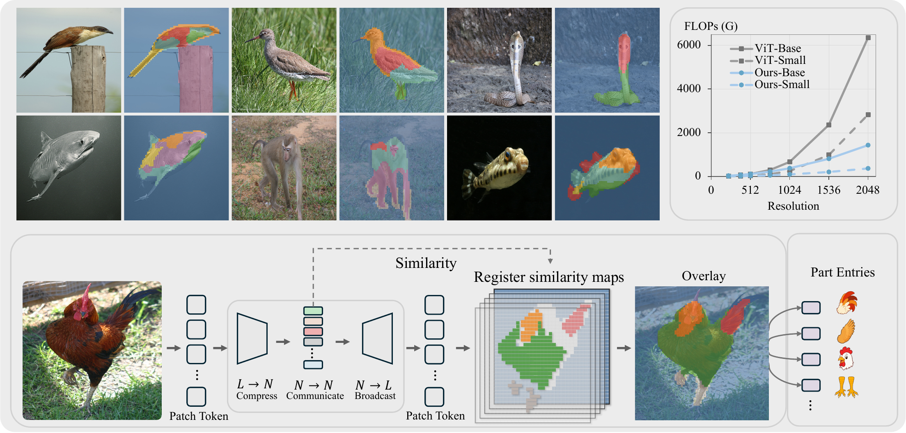
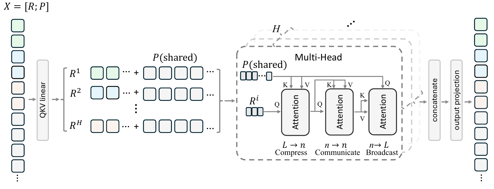
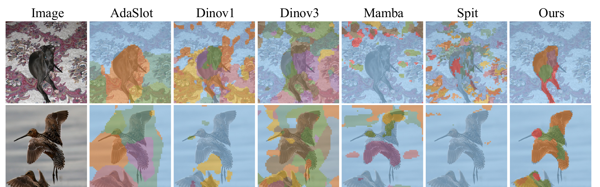
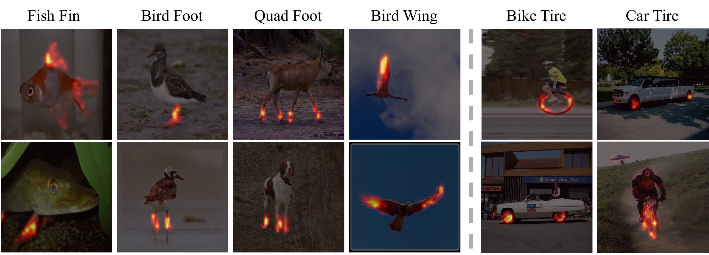

# [NeurIPS 2026] RATS! Patches Talk Through Registers: Emergent Parts in Register Attention Transformers

### 

[](https://arxiv.org/pdf/2606.14701v1)
[](https://huggingface.co/TimingYang/RATS)
[](https://huggingface.co/spaces/TimingYang/RATS)

> Timing Yang, Predrag Neskovic, Jansen Seheult, Wenchao Han, Anand Bhattad, Alan Yuille, Feng Wang\*

---

<p align="center">
  
</p>

## Overview

When humans see a bird, they recognize far more than just "bird" — they see a head, wings,
and talons, a structured assembly of reusable parts that can be identified across every bird
they have ever seen. We ask whether a self-supervised visual model can discover the same
compositional structure on its own. To this end, we propose **RATS** (**R**egister
**A**ttention **T**ransformer**s**), which decomposes the classification token into *N*
learnable register tokens that route patch information through an *L → N → N → L* bottleneck.
The *N* registers are hard-partitioned across *H* attention heads, structurally isolating each
subset in an independent projection subspace. Without auxiliary losses or part annotations,
each register spontaneously specializes into a semantically coherent visual part. RATS
surpasses all baselines by an average of +12 mIoU on five segmentation benchmarks, and
demonstrates stronger dense prediction on ADE20K (+1.11 mIoU) and COCO (+0.2 AP<sup>m</sup>).
The visual dictionary extracted from the trained registers also shows signs of part-level
consistency and semantic proximity across related categories. Our results suggest that RATS
may provide a useful architectural prior for structured and interpretable visual
representation learning.

## Method

<p align="center">
  
</p>

Each transformer block routes patch–patch communication through `N` register tokens via a
three-step **compress → communicate → broadcast** attention:

1. **Compress** — patches aggregate into `N` registers (`L → N`).
2. **Communicate** — registers exchange information among themselves (`N → N`).
3. **Broadcast** — registers send information back to patches (`N → L`).

The `N` registers are partitioned **exclusively** across the `H` attention heads, so each
head owns an independent register subset with no cross-head communication — structurally
guaranteeing diversity and letting part-level specialization emerge naturally.

## Visualization

<p align="center">
  
</p>

Unsupervised part segmentations from RATS compared against baselines — each register surfaces
a semantically coherent part without any annotation.

## Visual Dictionary

<p align="center">
  
</p>

Per-register similarity maps over the patch grid recover semantic parts, which we catalog
into a small dictionary of reusable **part entries**. Built without any part-level
supervision, this dictionary reveals a multi-level semantic organization:

- **Within-super-category consistency** — a single entry fires on the *same* part across
  different instances (e.g. *Bird_Head*, *Fish_Head*, *Aero_Tail*), closely matching
  human-annotated boundaries despite never seeing those labels.
- **Taxonomic proximity** — related categories share entries: *Snake_Head* and
  *Reptile_Head* transfer bidirectionally across turtles, lizards, and chameleons.
- **Functional analogy** — geometrically similar parts cluster together, so a *Car_Tire*
  entry also localizes bicycle, bus, and race-car wheels.

These patterns show the entries are genuinely reusable part concepts that emerge purely from
the register bottleneck.

## Installation

```bash
git clone https://github.com/yangtiming/RATS.git
cd RATS
pip install -r requirements.txt
```

Core: PyTorch, torchvision, numpy, scipy, matplotlib, pillow.
Part retrieval additionally needs scikit-learn + tqdm.

## Repository layout

```
RATS/
├── vision_transformer.py        # RATS / region-ViT backbone (L→N→N→L register attention)
├── utils.py  hubconf.py         # DINO utilities
├── main_dino.py                 # self-supervised training entry
├── rats_iter.py                 # recursive decompose → regroup (L1→Ld + similarity grouping)
├── draw_dominant_map.py         # per-patch dominant register/head maps
├── rats_partwhole.py            # head→register part/whole probe
├── extract_teacher.py           # pull the teacher weights out of a full checkpoint
├── scripts/                       # runnable entry points (self-locating)
│   ├── run_train_base.sh          #   train ViT-Base backbone  (N=192, 16/head)
│   ├── run_train_small.sh         #   train ViT-Small backbone (N=96,  16/head)
│   ├── run_train_dict.sh          #   train the register dictionary (frozen backbone)
│   ├── run_infer_rats.sh          #   RATS decomposition figures
│   └── run_infer_dominant_map.sh  #   dominant-map figures
├── retrieval_learnable/           # part retrieval (PartImageNet): demo_topk.py + run_base_dict4096.sh
└── output/                      # all run outputs land here (git-ignored)
    ├── <arch>_ps16_.../         #   training checkpoints
    ├── rats_iter/               #   run_infer_rats.sh figures
    └── dominant_map/            #   run_infer_dominant_map.sh figures
```

## Pretrained weights

Teacher checkpoints (backbone + head), saved every 20 epochs, are on the Hub at
[**TimingYang/RATS**](https://huggingface.co/TimingYang/RATS):

| variant | arch | embed | registers (per head) |
|---------|------|-------|----------------------|
| `base/`  | `region_vit_base`  | 768 | 192 (16 × 12 heads)
| `small/` | `region_vit_small` | 384 | 96  (16 × 6 heads) 

```python
import torch
from huggingface_hub import hf_hub_download
import vision_transformer as vits

ckpt = hf_hub_download("TimingYang/RATS", "base/checkpoint_teacher_ep00xx.pth")  # released base
state = torch.load(ckpt, map_location="cpu")["teacher"]
state = {k.replace("module.", "").replace("backbone.", ""): v for k, v in state.items()}

model = vits.region_vit_base(patch_size=16, num_register_tokens=192,
                             use_cross_attn=True, num_reg_for_loss_per_head=16)
model.load_state_dict(state, strict=False)   # head.* keys unused for features
model.eval()
```

## Usage

Paths in the `run_*.sh` scripts auto-detect the repo location; edit the data
paths (`./data/imagenet`, `./data/PartImageNet`) or symlink your datasets there.

**Train the backbone**
```bash
bash scripts/run_train_base.sh      # or run_train_small.sh
```

**Train the register dictionary** (freezes the pretrained backbone)
```bash
bash scripts/run_train_dict.sh
```

**RATS decomposition** — recursive decompose → regroup, one figure per image
(`output/rats_iter/`):
```bash
# put a checkpoint_teacher.pth at the repo root and images in demo_image1/
bash scripts/run_infer_rats.sh                           # all images in demo_image1/
MERGE_SIM=0.9 bash scripts/run_infer_rats.sh img.png     # one image, tune the grouping threshold
```

**Dominant maps** — color each patch by its dominant register/head
(`output/dominant_map/`):
```bash
bash scripts/run_infer_dominant_map.sh
```

**Part retrieval** (learned dictionary, PartImageNet) — build the codebook, match it
to PartImageNet parts, and evaluate part purity / decomposition:
```bash
bash retrieval_learnable/run_base_dict4096.sh              # auto-downloads backbone + codebook
MAX_IMAGES=XXXX bash retrieval_learnable/run_base_dict4096.sh   # quick smoke run
```

## Citation

```bibtex
@misc{yang2026ratspatchestalkregisters,
      title={RATS! Patches Talk Through Registers: Emergent Parts in Register Attention Transformers}, 
      author={Timing Yang and Predrag Neskovic and Jansen Seheult and Wenchao Han and Anand Bhattad and Alan Yuille and Feng Wang},
      year={2026},
      eprint={2606.14701},
      archivePrefix={arXiv},
      primaryClass={cs.CV},
      url={https://arxiv.org/abs/2606.14701}, 
}
```

## License & acknowledgement

Released under the Apache-2.0 License. Built on
[facebookresearch/dino](https://github.com/facebookresearch/dino).
